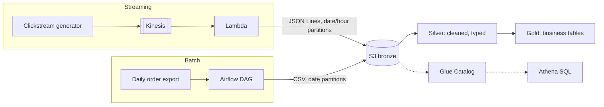

# E-commerce Lakehouse on AWS

A data platform for a simulated online store that handles both streaming and batch data. Clickstream events stream in through Kinesis and Lambda, daily orders arrive as files, and both move through bronze, silver and gold layers on S3, queryable with Athena.

**Stack:** Amazon Kinesis · AWS Lambda · S3 · PySpark · AWS Glue · Athena · Apache Airflow · IAM · Python

> Part of my portfolio at **[devanshi4.github.io](https://devanshi4.github.io)**

## Highlights

- **Streaming and batch in one platform:** clickstream through Kinesis and Lambda, daily orders through Airflow.
- **Medallion lakehouse on S3:** bronze, silver and gold layers in PySpark, queryable in Athena through the Glue catalog.
- **Clicks joined to purchases:** answers which devices convert, and how engagement relates to spend.

---

## The problem

An online store produces two very different kinds of data. Clickstream events (views, add-to-cart, purchases) arrive continuously, a few per second. Orders arrive once a day as an export. The business wants to see both together: what users clicked compared to what they bought, conversion by device, and revenue by category.

## How it works



**Streaming path**

1. `generate_clickstream.py` sends events to Kinesis at 5 per second, keyed by session so each visit stays in order.
2. Kinesis triggers the Lambda, which writes each batch of records to S3 as one JSON Lines file, partitioned by date and hour.
3. A Glue crawler registers the schema, so the data can be queried in Athena right away.

**Batch path**

1. An Airflow DAG runs daily at 06:00 UTC. It generates 200 orders and lands them in bronze.
2. It checks today's file exists before doing anything else.
3. It cleans the orders into silver, then builds gold tables.

**Transformations.** `jobs/medallion_job.py` does the full bronze → silver → gold work for both orders and clickstream in PySpark, writing Parquet, and joins clickstream to orders on `user_id`. It runs with `spark-submit` on a laptop, EMR or Glue, and stops the run if a layer comes out empty or more than 5% of rows are dropped. The Airflow DAG runs the same order transformations in pandas, so the daily job also runs locally without a Spark cluster.

## Design decisions

- **One file per Lambda batch.** Writing each event as its own S3 object would create thousands of tiny files, which slow down Spark and Athena. The Lambda writes each batch from Kinesis as one file.
- **Hive-style partitions.** Paths like `date=YYYY-MM-DD/hour=HH/` let Athena and Spark skip folders a query doesn't need, which cuts both run time and cost.
- **Medallion layers.** Bronze keeps data exactly as it arrived, so silver and gold can always be rebuilt. Silver is typed and validated. Gold is aggregated for specific business questions.
- **Shared users and products.** Both generators use the same user IDs and product catalog, so orders and clickstream join cleanly.
- **A quality gate between layers.** The Spark job counts rows in and out of every step and fails instead of publishing a half-empty gold table.
- **Least-privilege IAM.** Lambda and Glue each get their own role with only the permissions they need (see `lambda/*.json`).

## Data model

| Gold table | What it answers |
|---|---|
| `daily_revenue` | Revenue, order count and average order value per day |
| `revenue_by_category` | Which product categories drive revenue |
| `orders_by_status` | Completed, pending, cancelled and refunded orders |
| `device_conversion` | Purchase rate per device type: do mobile users convert less? |
| `user_journey` | Events, sessions and spend per user |
| `category_funnel` | Clickstream interactions compared with completed orders, per category |

## Run it locally

You need an AWS account with an S3 bucket, a Kinesis stream and a deployed Lambda, plus Docker for Airflow.

1. Set your bucket, stream and region in `data_generator/config.py`, and AWS credentials in a `.env` file.
2. Install dependencies:

   ```bash
   pip install -r requirements.txt
   ```

3. Load some order history, then stream clickstream events for two minutes:

   ```bash
   cd data_generator && python generate_orders.py
   ```

   ```bash
   python generate_clickstream.py
   ```

4. Start Airflow and trigger `ecommerce_daily_pipeline`:

   ```bash
   cd ../airflow && docker compose up -d
   ```

5. Run the PySpark transformations against local folders or your bucket:

   ```bash
   spark-submit jobs/medallion_job.py --base-path ./data
   ```

   ```bash
   spark-submit --packages org.apache.hadoop:hadoop-aws:3.3.4 jobs/medallion_job.py --base-path s3a://<your-bucket>
   ```

## Project structure

```
├── data_generator/              # Order and clickstream simulators, shared config
├── lambda/
│   ├── kinesis_to_s3/handler.py # Kinesis -> S3 bronze
│   └── *.json                   # IAM trust and permission policies
├── jobs/
│   └── medallion_job.py         # PySpark bronze -> silver -> gold, with a quality gate
├── notebooks/
│   └── medallion_transformations.ipynb  # the same logic, step by step
└── airflow/
    ├── dags/ecommerce_pipeline.py    # Daily batch DAG
    └── docker-compose.yml
```

## Status and next steps

- Trigger the Spark job from Airflow on EMR Serverless, so one DAG runs both paths end to end.
- Write silver and gold as Iceberg tables to get upserts and time travel.
- Define the S3 bucket, Kinesis stream, Lambda and IAM roles in Terraform.

---

Built by **Devanshi Pandya** · [Portfolio](https://devanshi4.github.io) · [LinkedIn](https://www.linkedin.com/in/devanshi4/)
